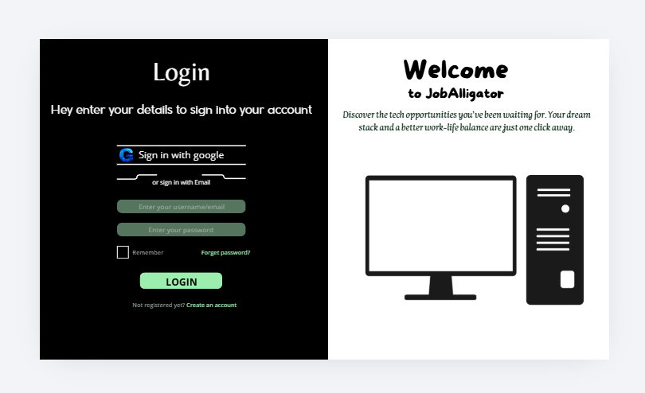
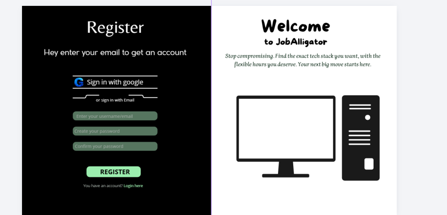
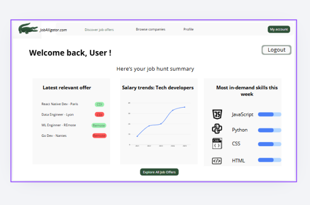
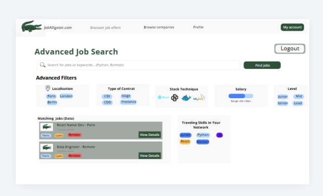
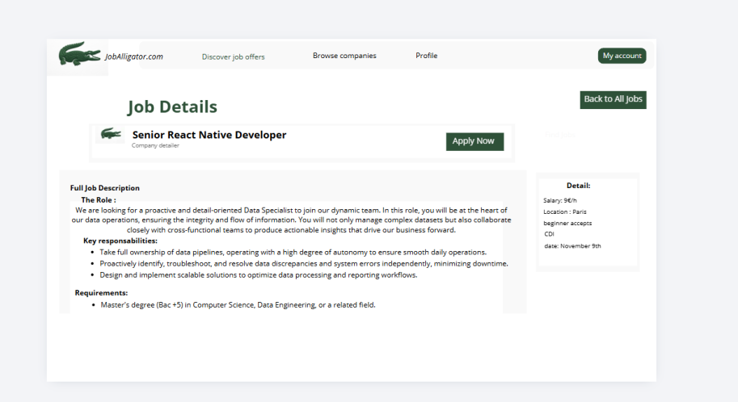

# Rapport Job Aggregator

---

## 1. Analyse des tendances, acteurs et solutions concurrentes

Le marché du recrutement tech est saturé d'offres, mais l'expérience candidat reste souvent frustrante en raison du manque de standardisation des données (salaires cachés, stacks techniques floues). 

**Analyse des acteurs actuels :**

* **Les acteurs générals (LinkedIn, Indeed) :**
    * *Forces :* Volume d'offres massif, réseau intégré (LinkedIn).
    * *Faiblesses :* filtres techniques peu pertinents pour les développeurs, données non standardisées.
* **Les Spécialistes (Welcome to the Jungle) :**
    * *Forces :* Marque employeur très forte, belle interface, focus sur la culture d'entreprise.
    * *Faiblesses :* La recherche par stack technique précise ou par télétravail exact est parfois laborieuse. Le salaire est souvent absent.
* **Notre Partenaire (WeLoveDevs) :**
    * *Forces :* Centré sur les développeurs, données de qualité, écosystème pertinent.
    * *Notre positionnement :* Nous n'allons pas concurrencer WeLoveDevs, mais construire *par-dessus* en utilisant leur API pour apporter une nouvelle couche d'analyse Data et de simplification par l'IA.

---

## 2. Identification des besoins des utilisateurs

**Cible principale :** Étudiants en informatique et développeurs juniors cherchant un stage, une alternance ou un premier emploi.

**Points de douleur identifiés :**
1.  **La perte de temps à la lecture :** Devoir lire de longs paragraphes génériques pour finalement découvrir que les technologies demandées ne correspondent pas.
2.  **L'opacité des salaires :** Ne pas savoir si la rémunération proposée est en accord avec les prix du marché actuel pour les profils juniors.
3.  **La difficulté de comparaison :** Il est complexe de mettre deux offres côte à côte et de les comparer objectivement sur des critères précis (Télétravail, Stack, Salaire, Localisation).

---

## 3. Proposition de valeur

> **"L'agrégateur d'offres tech qui fait gagner du temps aux développeurs en extrayant l'essentiel grâce à l'IA, tout en offrant une vision claire du marché grâce à la Data."**

Notre plateforme centralise les meilleures opportunités tech (via WeLoveDevs) et utilise l'Intelligence Artificielle pour extraire immédiatement les mots-clés et compétences requises de chaque description. De plus, notre tableau de bord Data permet aux utilisateurs d'analyser les tendances du marché pour les aider à faire de meilleurs choix de carrière.

---

## 4. Maquettes filaires (Wireframes) pour les vues clés

Note : Les maquettes ont été réalisées sur Canva.

lien du canva: https://canva.link/d49gpg330bbtu0g

**Détail des vues conçues :**

* **Vue 1 : Interface d'introduction du site **
* *Description :* Premiere vision du site.
* *Aperçu :* 

* **Vue 2 : Inscription et Authentification **
    * *Description :* Login (Email, Mot de passe).
    * *Aperçu :* 

    * *Description :* Register.
    * *Aperçu :* 
* **Vue 3 : Tableau de bord Utilisateur (Dashboard) **
    * *Description :* Écran principal post-connexion. 
    * *Intégrations :* Affiche les dernières offres pertinentes. Intègre un graphique de tendances salariales et un encart "Compétences les plus demandées cette semaine" généré par notre IA.
    * *Aperçu :* 
* **Vue 4 : Recherche et filtrage d'offres **
    * *Description :* Barre de recherche avec filtres avancés (Localisation, Contrat, Stack technique).
    * *Aperçu :* 
* **Vue 5 : Détails de l'offre **
    * *Description :* Page standardisée affichant le titre, l'entreprise, le lieu, le contrat, la date, le salaire (si dispo) et la description. 
    * *Aperçu :* 
* **Vue 6 : Interface d'Administration **
    * *Description :* Vue réservée aux rôles Admin pour gérer les utilisateurs et modérer les offres importées.
    * *Aperçu :* `[Insérer une image/capture du wireframe ici]`