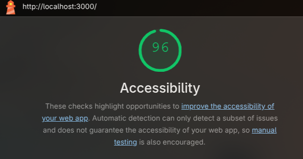
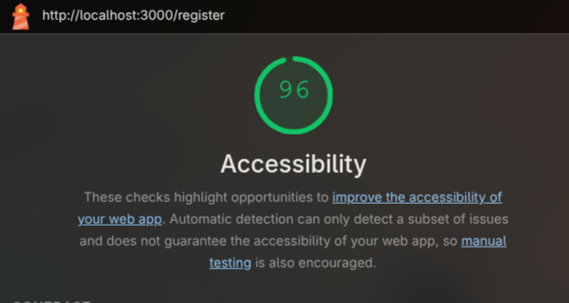
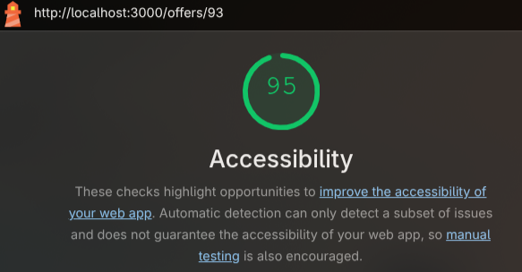
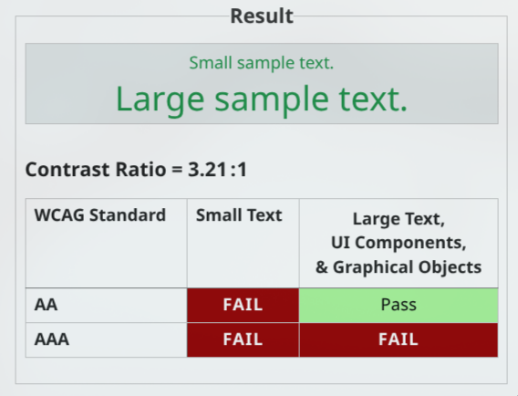

# Accessibility Audit

**Outil :** Lighthouse (Chromium DevTools)  
**Date :** 21/05/2025  
**Standard visé :** WCAG 2.1 Level AA  

---

## Résultats

| Page | Score Lighthouse |
|------|-----------------|
| Home (recherche d'offres) | 96/100 |
| Register | 96/100 |
| Offer Detail | /100 |

---

## Captures d'écran

### Home

### Register

### Offer Detail

---

## Pourquoi ?

### Score résiduel

Le score de 96/100 reflète des avertissements détectés par Lighthouse,
qui ne constituent pas des violations WCAG 2.1 Level AA.

Les avertissements résiduels concernent uniquement des ratios de contraste sur du texte de petite taille. Or, selon WCAG 2.1, 
les exigences de contraste renforcées (3:1) ne s'appliquent qu'aux éléments graphiques significatifs et au texte agrandi (18pt ou 14pt en gras). 
Ces avertissements ne constituent donc pas des violations Level AA.

---

## Mesures d'accessibilité en place

- Skip link vers le contenu principal (`#main-content`)
- Balises HTML correcte (`<nav>`, `<main>`, `<section>`, `<form>`)
- Hiérarchie de titres respectée (h1 → h2 → h3)
- Tous les inputs ont un `<label>` associé via `htmlFor`
- `aria-label` sur les régions principales
- `aria-hidden="true"` sur les icônes décoratives
- `aria-live="polite"` sur les contenus dynamiques
- `aria-busy` sur les états de chargement
- `role="alert"` sur les messages d'erreur
